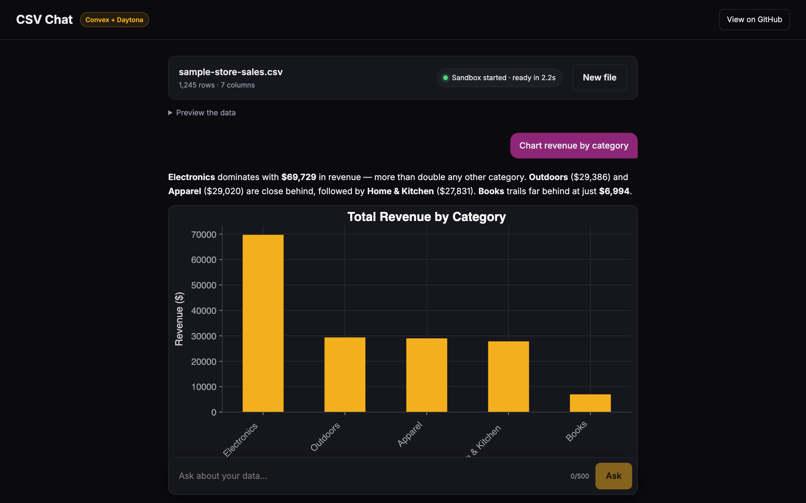
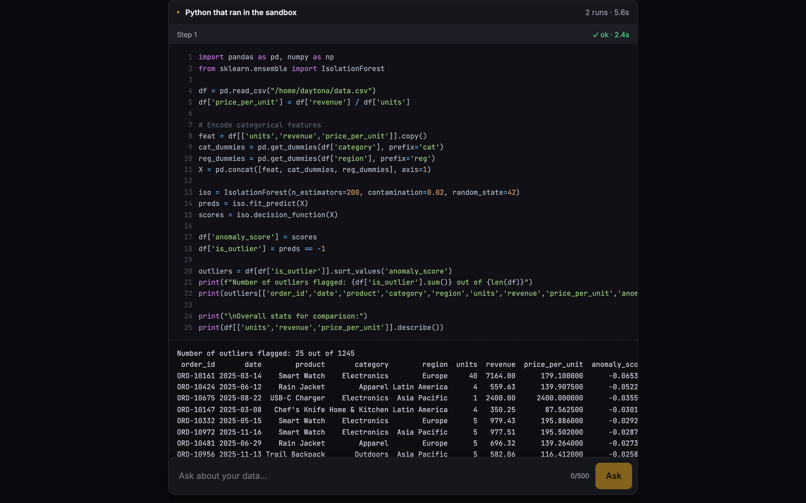

# CSV Chat: chat with your data, powered by Convex + Daytona

Upload a CSV (or click "Try with sample data") and ask questions like "which month had the most revenue?", "chart revenue by category" or "any weird outliers?".

An AI agent running on [Convex](https://convex.dev) answers by writing Python (pandas, matplotlib, seaborn) and running it in a [Daytona](https://www.daytona.io) sandbox. It reads the output, runs more code if it needs to (up to 4 runs per question), fixes its own errors, then answers in plain words with a chart when it helps. You can open up every snippet it ran, with its output.





**Try the live demo:** TODO: live demo link

## Why a sandbox?

Convex actions run JavaScript only: no Python, no pandas, no shell. And you don't want code an LLM just wrote running next to your database and API keys anyway. A Daytona sandbox is a separate, throwaway computer with Python and the data science stack already installed. The [`@daytona/convex`](https://www.convex.dev/components/daytona/convex) component wires it into Convex, so an action can create a sandbox, write files, run code and read results.

Convex then does what it's good at:

- **Reactive UI, no polling.** Messages and every agent step (the code, its output, any error) are documents. The UI subscribes with `useQuery`, so you watch the agent work step by step.
- **Durable.** The agent runs in a scheduled action, not in your browser. Refresh mid-answer, or close the tab, and it carries on.
- **File storage.** Uploaded CSVs and the generated charts live in Convex file storage.
- **Scheduler and crons.** The agent is kicked off with `ctx.scheduler`, and a cron resets the public demo every 12 hours.

## Run your own

```bash
git clone https://github.com/get-convex/convex-daytona-csv-chat
cd convex-daytona-csv-chat
npm install
npx convex dev            # creates a Convex project, then leave it running (or Ctrl+C)
npx convex env set DAYTONA_API_KEY dtn_...   # get one at https://app.daytona.io/dashboard/keys
npm run dev
```

Open the URL Vite prints, and click "Try with sample data".

The LLM goes through the [Convex AI Gateway](https://docs.convex.dev/ai-gateway/setup), so there's no OpenAI or Anthropic key to manage. It needs a cloud deployment on a paid Convex team. To use your own OpenAI key instead, `npm install @ai-sdk/openai`, run `npx convex env set OPENAI_API_KEY sk-...` and change two lines in `convex/agent.ts`:

```ts
import { openai } from "@ai-sdk/openai"; // instead of convexGateway
model: openai("gpt-5.4"),                // instead of convexGateway(MODEL)
```

To host the frontend on Convex too (it's served from `https://<deployment>.convex.site` by [`@convex-dev/static-hosting`](https://github.com/get-convex/static-hosting)): `npm run deploy`.

## How it works

| File | What it does |
| --- | --- |
| `convex/chats.ts` | Public API: upload URL, create a chat, ask a question, and the queries the UI subscribes to. |
| `convex/agent.ts` | The agent: sets up the sandbox after upload, then the `run_python` tool loop with the AI SDK. |
| `convex/sandbox.ts` | Every Daytona call: create the sandbox, run Python, collect charts. |
| `convex/limits.ts` | All the abuse limits, as constants at the top. |
| `convex/reset.ts`, `convex/crons.ts` | The 12 hour demo reset. |
| `src/` | The React UI. `Message.tsx` renders the code the agent ran. |

1. The browser uploads the CSV straight to Convex file storage with an upload URL. `createChat` checks it's a `.csv` under 1 MB and schedules `agent.setupChat`.
2. `setupChat` checks the file is really UTF-8 CSV, saves the columns and first rows, then creates a sandbox (one per chat) and writes the CSV into it.
3. When you ask a question, `ask` saves your message plus an empty "thinking" answer, and schedules `agent.answer`.
4. `answer` calls the model with a `run_python` tool, and gives it the columns and first few rows up front so it doesn't waste a step looking. Each tool call writes a `steps` document (the UI shows it running), runs the code, and saves the output. A Python error isn't an exception: the traceback goes back to the model, which fixes its code and tries again.
5. The final answer streams into the message document, so it appears as it's written.

The Daytona part is short. From `convex/sandbox.ts`:

```ts
const { sandboxId } = await daytona.createSandbox(ctx, {
  labels: { app: APP_NAME },
  userKey: args.sessionId,
  autoStopInterval: SANDBOX_AUTO_STOP_MINUTES,
  autoDeleteInterval: SANDBOX_AUTO_DELETE_MINUTES,
});
await daytona.writeFile(ctx, { sandboxId, path: CSV_PATH, content: args.csv });

// ...then for every tool call:
const { exitCode, result } = await daytona.runCode(ctx, {
  sandboxId,
  code,
  language: "python",
  timeoutSeconds: PYTHON_TIMEOUT_SECONDS,
});
```

### Charts: why SVG?

Files cross the Daytona component as UTF-8 strings, so a PNG would get mangled on the way out. Instead the agent saves charts as SVG (`plt.savefig("/home/daytona/out/chart.svg")`), which is text. After each run, `collectCharts` lists `/home/daytona/out`, reads each SVG with `readFile`, stores it in Convex file storage and deletes it from the sandbox.

The UI shows charts with a plain ``. Never inject SVG into the page with `innerHTML`: SVG can carry scripts, and an `` never runs them.

The charts match the dark UI because the sandbox gets a `matplotlibrc` with the theme and colours, so the agent's code stays clean.

## Abuse protection

This runs as a public demo, and every question costs real sandbox and LLM money. All the knobs are constants at the top of [`convex/limits.ts`](convex/limits.ts):

- **Anonymous session id:** a random UUID in localStorage scopes your chats, rate limits and sandboxes (`userKey`). It's spoofable, so there are global limits too.
- **Rate limits** with [`@convex-dev/rate-limiter`](https://www.convex.dev/components/rate-limiter): 6 questions per session per hour and 60 across everyone, plus limits on uploads. You get a friendly message when you hit one.
- **Concurrency cap:** no new sandbox if 8 of this app's sandboxes are already live.
- **Input caps:** questions up to 500 characters, files up to 1 MB, capped LLM output, max 4 Python runs per question, 60 s per run.
- **Short-lived sandboxes:** labelled `app: convex-daytona-csv-chat`, auto-stop after 10 idle minutes and auto-delete after 60. If a chat's sandbox is gone when you ask again, a new one is created and the CSV re-written from file storage.
- **12 hour reset:** a cron runs `reset:resetDemo`, which deletes every sandbox this app created, then wipes the chats, messages, steps and uploaded files. It's safe to run any time: `npx convex run reset:resetDemo`.

## Links

- [`@daytona/convex` component](https://www.convex.dev/components/daytona/convex)
- [Daytona docs](https://www.daytona.io/docs)
- [Convex docs](https://docs.convex.dev)

## License

Apache-2.0. See [LICENSE](LICENSE).
